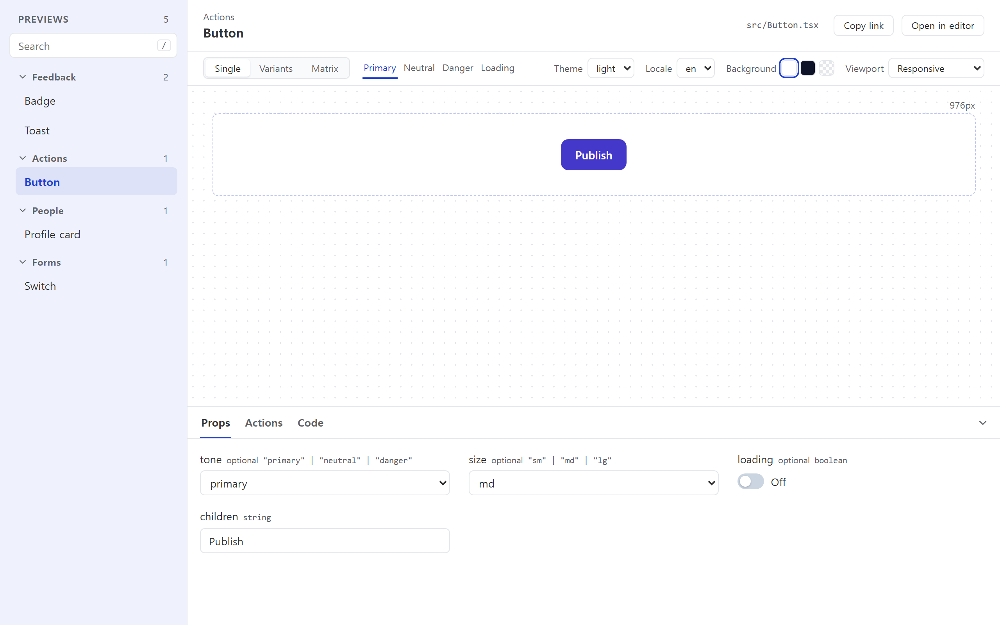
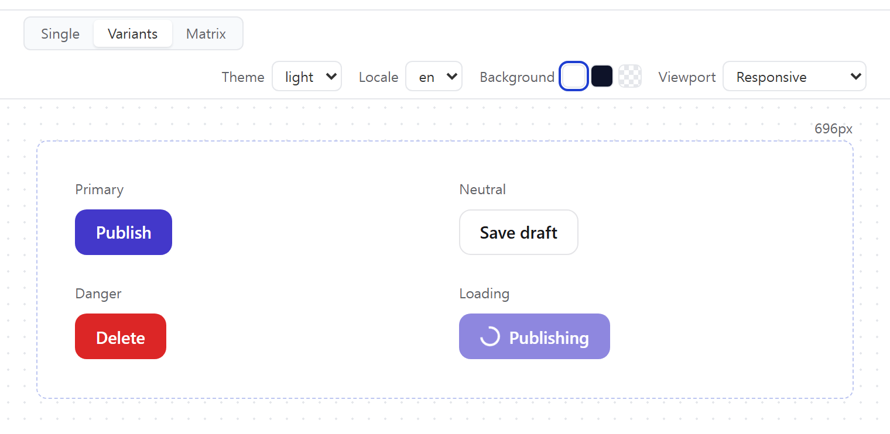
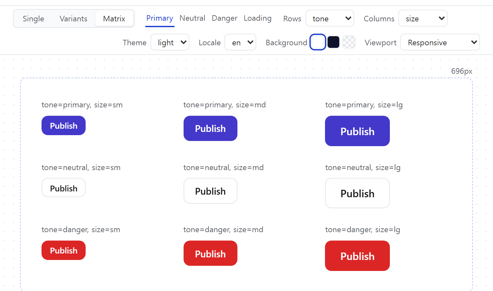
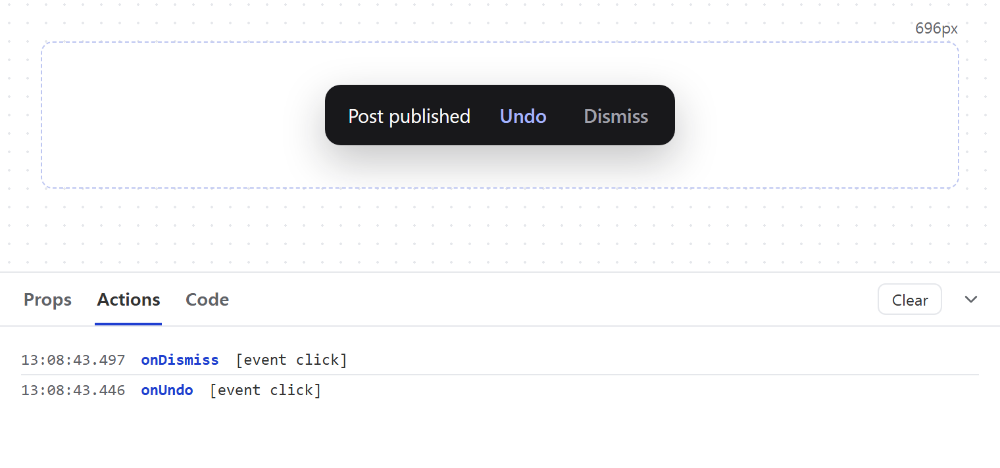
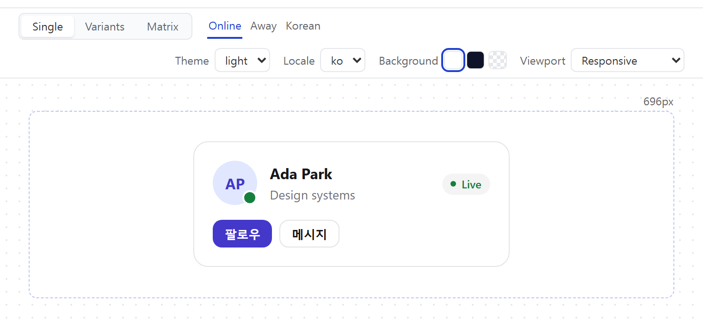
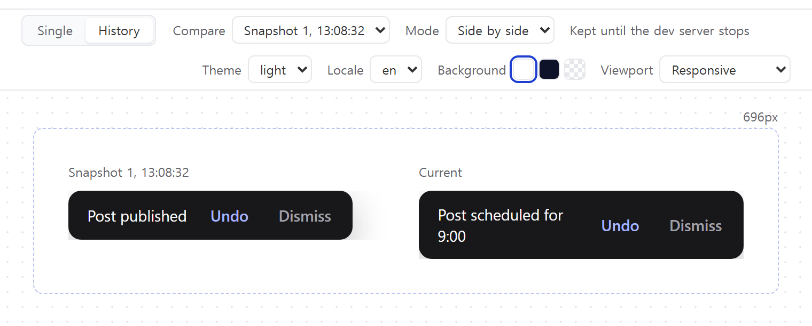

# Vitrine

[English](./README.md)

<p align="center">
  
</p>

[공식 사이트](https://vitrine-4kr.pages.dev/ko) · [라이브 데모](https://vitrine-4kr.pages.dev/demo/) · [문서](https://vitrine-4kr.pages.dev/ko/docs) · [npm](https://www.npmjs.com/package/vite-plugin-react-vitrine) · [VS Code](https://marketplace.visualstudio.com/items?itemName=yuntaengtaeng.vitrine)

편집 중인 파일 바로 옆에서 보는 React용 Jetpack Compose 스타일 프리뷰입니다.

컴포넌트 export 위에 `/** @preview */`를 붙이면 Vite dev server가 실시간 갤러리로
렌더링하고, VS Code 확장이 그 갤러리를 에디터 옆에 보여줍니다.

```tsx
/** @preview name="Inputs/Primary button" */
export const PrimaryButton = () => <Button variant="primary">Save</Button>;
```

<picture>
  <source media="(prefers-color-scheme: dark)" srcset="./apps/website/public/screenshots/gallery-dark.png" />
  
</picture>

설치 없이 [라이브 데모](https://vitrine-4kr.pages.dev/demo/)에서 바로 써 보세요.

## 왜 Vitrine인가

- **프리뷰가 코드 옆에 있습니다.** 프리뷰는 export 위의 주석입니다. 따로 맞춰야 하는
  stories 파일이 없습니다.
- **렌더링은 사용자의 Vite 설정이 담당합니다.** alias, plugin, CSS, HMR이 앱과 똑같이
  동작합니다.
- **Provider를 프리뷰 안에서 실행합니다.** 선택적인 setup file로 stateful context provider를
  갤러리의 프리뷰 tree에 마운트할 수 있습니다.
- **에디터가 주 인터페이스입니다.** 커서를 프리뷰 위로 옮기면 패널이 그 프리뷰로
  바뀝니다. 브라우저 갤러리만 따로 써도 됩니다.
- **필요하면 배포합니다.** `vitrine-plugin-static`이 앱 build는 그대로 두고 리뷰용 정적 갤러리를
  만듭니다.

## 갤러리에 있는 것

| | |
| --- | --- |
|  | **Variants.** `preview()`로 prop 묶음에 이름을 붙여 나란히 펼쳐 봅니다. |
|  | **Matrix.** prop 두 개의 모든 조합을 한 번에 렌더링합니다. |
|  | **Actions.** `on*` prop 호출이 인자와 함께 기록됩니다. |
|  | **Globals.** 테마, 언어 같은 provider 값을 toolbar에서 고릅니다. |
|  | **History.** 지금 버전을 이전 저장본과 비교합니다. |

Props는 타입에서 만들어지고, 링크는 같은 상태를 다시 엽니다. VS Code에서는 패널이 커서를 따라가고
지금 props를 variant로 저장할 수 있습니다.

## 시작하기

설치, 프리뷰 선언, controls, variants와 provider 설정은
[vite-plugin-react-vitrine README](./packages/vite-plugin/README.ko.md)를 참고하세요. 갤러리 배포는
[vitrine-plugin-static](./packages/plugin-static/README.ko.md)을 참고하세요.

에디터 옆에서 프리뷰를 보려면 Visual Studio Marketplace에서 [Vitrine for VS Code](https://marketplace.visualstudio.com/items?itemName=yuntaengtaeng.vitrine)를 설치하세요.

## 저장소 구성

| 경로 | 설명 |
| --- | --- |
| `packages/vite-plugin` | 배포되는 Vite plugin과 갤러리, `vite-plugin-react-vitrine` |
| `packages/plugin-static` | 정적 갤러리를 만드는 공식 plugin, `vitrine-plugin-static` |
| `packages/protocol` | plugin, 갤러리, 확장이 공유하는 비공개 runtime 계약 |
| `apps/vscode-extension` | 갤러리를 패널에 보여주는 VS Code 확장, [Vitrine for VS Code](https://marketplace.visualstudio.com/items?itemName=yuntaengtaeng.vitrine) |
| `examples/react-basic` | 개발과 e2e 테스트용 예제 앱 |
| `examples/showcase` | 스크린샷과 라이브 데모용 컴포넌트 |
| `apps/website` | 공식 사이트, 라이브 데모는 `/demo/` |
| `fixtures/multi-project` | 프로젝트 전환 테스트용 앱 두 개 |
| `tests/compat` | 버전을 고정한 React, Vite 호환성 조합 |

```text
VS Code 패널 -> <iframe src="http://localhost:<port>/__vitrine">
                  |
                Vite dev server + vite-plugin-react-vitrine
                  @preview export를 스캔하고 갤러리를 제공
```

확장은 컴포넌트를 직접 번들링하거나 렌더링하지 않습니다. plugin이 기록한
`.vitrine/port.json`으로 실행 중인 dev server를 찾아 갤러리 페이지를 띄울 뿐입니다.

## 개발

Issue나 pull request를 열기 전에 [CONTRIBUTING.ko.md](CONTRIBUTING.ko.md)를 읽어 주세요.

```bash
pnpm install
pnpm run build            # plugin과 갤러리 빌드
pnpm run dev:example      # 예제 앱 실행
pnpm run test             # 단위 테스트
pnpm run lint
pnpm run test:e2e         # build 후 Playwright 테스트 실행
pnpm run screenshots      # README와 사이트가 쓰는 스크린샷 다시 찍기
```

`http://localhost:5173/__vitrine`에서 예제 갤러리를 볼 수 있습니다.

확장을 실행하려면 예제 dev server를 켜둔 채 다른 터미널에서 실행합니다.

```bash
pnpm run build:extension
pnpm run dev:host         # Extension Development Host 실행 (PATH에 `code` 필요)
```

VS Code에서 이 폴더를 열고 **F5**를 눌러도 됩니다. 그다음 명령 팔레트에서
**Vitrine: Open Preview**를 실행합니다.

### 배포 전 검증

```bash
pnpm run test:package             # 패킹한 plugin을 빈 소비자 프로젝트에 설치해 검증
pnpm run test:extension-package   # 확장 번들 검증
pnpm run test:compat              # 모든 React, Vite 호환성 조합 실행
```

## 호환성

`vite-plugin-react-vitrine`은 React 18, 19와 Vite 6.4+, 7, 8을 지원합니다. 다음 조합은
호환성 검증 때마다 확인합니다.

| React | Vite | TypeScript |
| --- | --- | --- |
| 18.3.1 | 6.4.3 | 5.6.3 |
| 18.3.1 | 7.3.6 | 5.9.3 |
| 19.2.8 | 8.2.2 | 5.9.3 |

각 조합은 정확한 버전을 고정합니다. 새 메이저 버전을 지원할 때는 기존 조합을 바꾸지
않고 새 조합을 추가합니다.

## 라이선스

[MIT](./LICENSE)
